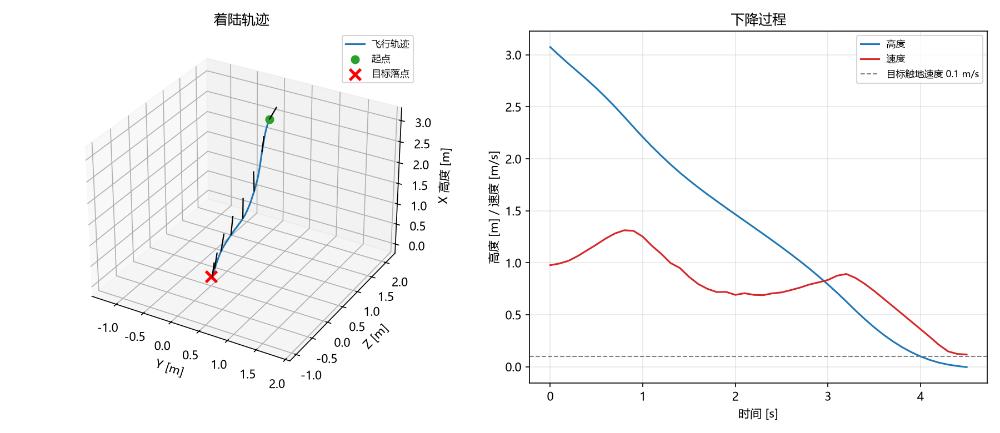
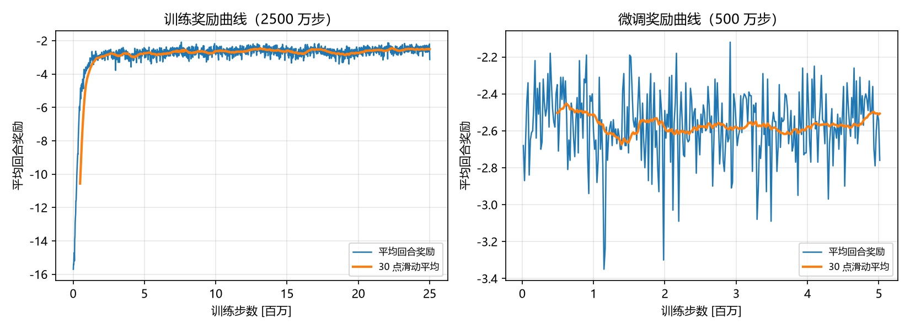

# Rocket Landing 6-DoF

使用 PPO 训练的六自由度火箭动力着陆强化学习项目。火箭在三维空间中从随机初始状态起飞，通过调节推力大小、喷口倾角和方位角，最终垂直软着陆到原点。



左图为最终模型的着陆轨迹与姿态（黑色箭头为箭体朝向），右图为高度与速度随时间的下降过程。

## 特性

- **六自由度动力学**：质量、位置、速度、四元数姿态、机体角速度，共 14 维状态。
- **4 维连续动作**：推力大小 `T`、喷口倾角 `δ`、方位角的 `cos θ / sin θ`。
- **稠密引导奖励 + 终端奖励**：速度引导、姿态偏差、燃料消耗、着陆速度惩罚、下滑道约束。
- **Gymnasium 环境**，使用 [Stable-Baselines3](https://github.com/DLR-RM/stable-baselines3) 的 PPO 训练。
- 3D 轨迹渲染，可查看火箭姿态、推力方向与着陆过程。

## 动力学来源

动力学模型（状态方程、四元数运动学、质量流模型等）参考并改编自 [PythonRobotics](https://github.com/AtsushiSakai/PythonRobotics) 的火箭着陆示例（MIT License，作者 Atsushi Sakai），详见 [rocket_gym.py 顶部说明](rocket_gym.py)。

## 环境要求

- Python 3.10+
- `gymnasium`、`stable-baselines3`、`numpy`、`matplotlib`

```bash
pip install gymnasium stable-baselines3 numpy matplotlib
```

## 文件结构

| 文件 | 说明 |
|---|---|
| `rocket_gym.py` | Gymnasium 环境，包含动力学、奖励、终止判定与渲染 |
| `ppo.py` | PPO 训练脚本，支持检查点与断点续训 |
| `ppo_test.py` | 加载模型并 3D 渲染查看着陆效果 |
| `model_ppo.zip` | 训练好的模型（当前最佳） |
| `checkpoints_v3/` | 微调阶段的检查点 |
| `assets/` | README 配图（训练曲线、着陆轨迹） |

## 训练

```bash
python ppo.py
```

训练曲线（橙线为 30 点滑动平均）：



三个阶段依次为：基础训练、加入着陆速度惩罚、放宽下滑道约束后微调。第一阶段的奖励在约 2400 万步后趋于平台，因此后续不再盲目延长训练。

## 查看效果

```bash
python ppo_test.py
```

运行后会弹出 3D 动画窗口，播放火箭着陆轨迹。可在 `ppo_test.py` 顶部调整：

- `RENDER_PAUSE`：每帧暂停秒数（越小越快）
- `NUM_EPISODES`：测试回合数
- `MODEL_PATH`：切换不同版本模型

## 训练结果

经过三阶段训练（基础 → 加入着陆速度惩罚 → 放宽下滑道约束微调），最终模型在 5 回合确定性评估中：

- 平均触地速度约 **0.2 m/s**（目标 0.1 m/s）
- 平均落点偏差约 **0.04 m**
- 所有回合均正常触地，无提前截断

## License

MIT
